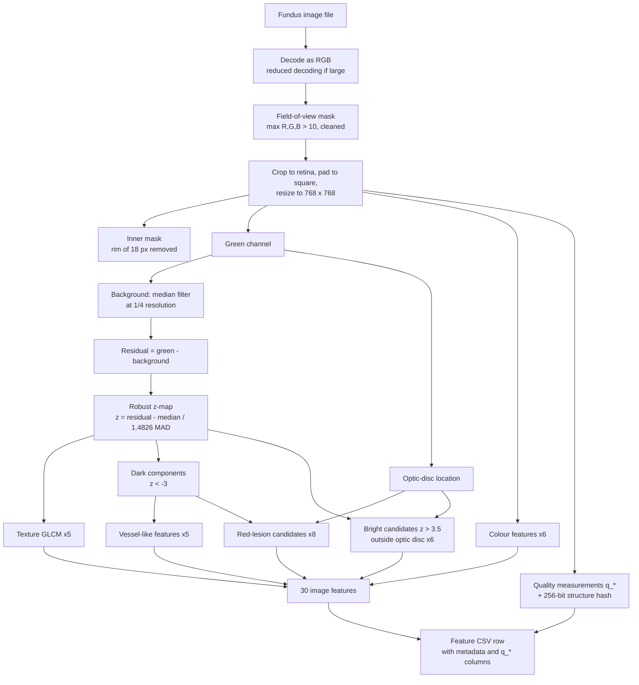

<a id="top"></a>

# DRGrade Edge: CPU-Accelerated Diabetic Retinopathy Grading

**Interpretable, handcrafted-feature machine learning for 5-grade diabetic retinopathy (DR) grading from retinal fundus photographs, designed for lightweight CPU inference.**


> [!IMPORTANT]
> This is a research and university project, **not a medical device**. Model outputs are predictions, not diagnoses. The lesion "candidates" described below are image-processing detections that have **not** been validated against clinical lesion annotations.

---

## Contents

1. [Overview](#1-overview)
2. [Key features](#2-key-features)
3. [Pipeline at a glance](#3-pipeline-at-a-glance)
4. [Image processing: one image, step by step](#4-image-processing-one-image-step-by-step)
5. [Feature reference](#5-feature-reference)
6. [Dataset](#6-dataset)
7. [Processed feature files](#7-processed-feature-files)
8. [Duplicate detection and leakage audit](#8-duplicate-detection-and-leakage-audit)
9. [Machine-learning pipeline](#9-machine-learning-pipeline)
10. [Results](#10-results)
11. [Repository structure](#11-repository-structure)
12. [Setup and reproducibility](#12-setup-and-reproducibility)
13. [Limitations and roadmap](#13-limitations-and-roadmap)
14. [Acknowledgements](#14-acknowledgements)

---

## 1. Overview

DRGrade Edge converts each fundus photograph into a fixed-length vector of **interpretable numeric descriptors** (colour statistics, texture, vessel-like structures, dark and bright lesion-like candidates) and classifies it with classical models (logistic regression, SVMs, random forest, k-nearest neighbours).

| Grade | Meaning |
|---|---|
| 0 | No diabetic retinopathy |
| 1 | Mild non-proliferative DR |
| 2 | Moderate non-proliferative DR |
| 3 | Severe non-proliferative DR |
| 4 | Proliferative DR |

**Current implementation vs planned work**

| | Status |
|---|---|
| Resolution-independent preprocessing and 30-feature extraction (`src/drgrade/`) | Implemented, in this repository |
| Parallel feature extraction to CSV, quality measurements, structure hash | Implemented, in this repository |
| Hash-based duplicate grouping and split checks (`scripts/make_splits.py`) | Implemented, in this repository |
| Image-verified duplicate audit, baseline training and evaluation | Run locally; results reported below; **scripts not yet committed** |
| INT8 quantization, C99/OpenMP inference, Raspberry Pi deployment | **Planned / in progress; not in this repository** |

<p align="right"><a href="#top">↑ back to top</a></p>

---

## 2. Key features

- **Resolution-independent preprocessing.** Every image is cropped to its retina and resized so the retina spans 768 px, so all pixel parameters mean the same physical scale across cameras.
- **Illumination normalization.** A median-filter background estimate and a robust z-score map make lesion detection relative to *local* brightness, not absolute intensity.
- **One shared z-map** drives the vessel, red-lesion, bright-lesion and texture features.
- **Optic-disc handling.** The disc is located and excluded from bright-candidate and red-candidate counts.
- **Per-image quality measurements** (exposure, sharpness, noise, retina coverage) and a **256-bit structure hash** for duplicate detection.
- **Multi-process extraction** with per-stage timing and failure reporting.
- **Leakage awareness.** Duplicate images across train/validation/test were audited; results are reported on both the original test set and a leakage-controlled subset.

<p align="right"><a href="#top">↑ back to top</a></p>

---

## 3. Pipeline at a glance



<p align="right"><a href="#top">↑ back to top</a></p>

---

## 4. Image processing: one image, step by step

All parameters below are the defaults in [`src/drgrade/config.py`](src/drgrade/config.py). Pixel sizes refer to the 768-px working image unless stated otherwise.

### 4.1 Loading and decoding ([`preprocess.decode`](src/drgrade/preprocess.py))
1. The original width and height are read from the file header with Pillow (`q_orig_w`, `q_orig_h`).
2. If the image is large, OpenCV's reduced decoding (`IMREAD_REDUCED_COLOR_2/4/8`) is used: the largest factor *f* ∈ {8, 4, 2} with min(w, h) / f ≥ 1.15 × 768 is chosen (`q_decode_factor`; 1 = full decode).
3. The image is converted from OpenCV's BGR order to RGB.

### 4.2 Retina detection, cropping and resizing ([`fov_mask`, `crop_to_retina`](src/drgrade/preprocess.py))
1. **Field-of-view (FOV) mask:** a pixel belongs to the retina if `max(R, G, B) > 10`. The mask is cleaned with a morphological opening then closing (elliptical kernel, size ≈ 1% of the image), reduced to its largest connected component, and its holes are filled.
2. The FOV is first located on a copy scaled to 512 px (for speed). Its bounding box is then cropped from the full-resolution image.
3. The crop is **padded to a square** with black borders, which preserves the circular geometry when the top and bottom of the retina are cut off by the camera.
4. The square is resized to **768 × 768** (area interpolation when shrinking, bilinear when enlarging; cubic interpolation is avoided because its overshoot creates false dark/bright spots).
5. The FOV mask is recomputed at 768 px. An **inner mask** removes an 18-px rim (elliptical erosion, kernel 37 × 37), because the retina edge is affected by vignetting. Images whose inner mask covers less than 20% of the 768 × 768 frame are rejected as failed.

### 4.3 Illumination normalization: the z-map ([`shade_correct`](src/drgrade/preprocess.py))
Only the **green channel** *G* is used here. In fundus photographs it usually gives the best contrast for vessels and lesions.

1. *G* and the inner mask are downscaled by 4 (to 192 × 192); the mask is eroded by 3 × 3 to drop mixed rim pixels.
2. **Edge extension:** pixels outside the retina are filled outward, 17 iterations, each new pixel taking the mean of its already-filled 3 × 3 neighbours. This stops the dark border from pulling the background estimate down near the rim.
3. **Background** *B* = 17 × 17 median filter at 1/4 resolution, upsampled bilinearly in floating point. The kernel (≈ 9% of the retina diameter) is much larger than lesions, so it follows illumination, not structures.
4. **Residual and robust z-score** over inner-mask pixels:

$$
r = G - B,\qquad
z = \frac{r - \operatorname{median}(r)}{\sigma},\qquad
\sigma = \max\bigl(1.4826\cdot\operatorname{median}\lvert r - \operatorname{median}(r)\rvert,\ 0.5\bigr)
$$

*z* is set to 0 outside the inner mask. **Negative *z*** = darker than the local background (vessels, red-lesion-like spots); **positive *z*** = brighter (exudate-like spots, optic disc, reflections). Using the median absolute deviation (MAD) makes the scale robust to the structures themselves; σ is recorded as `q_noise_sigma`.

### 4.4 Colour features ([`color_features`](src/drgrade/features.py))
Computed over inner-mask pixels of the 768-px RGB image. Medians are exact, computed from 256-bin histograms; means and standard deviations come from one pass of `cv2.meanStdDev`. Ratios and coefficients of variation are used instead of raw intensities, to reduce sensitivity to camera exposure.

### 4.5 Texture: grey-level co-occurrence matrix ([`texture_features`](src/drgrade/features.py))
1. *z* is clipped to [−3, 3) and quantized to **8 levels**: $q = \lfloor (z + 3) / 6 \cdot 8 \rfloor$.
2. For each of **4 directions** (0°, 45°, 90°, 135°) at distance 1, a GLCM counts how often level *i* is next to level *j*, **counting only pairs where both pixels are inside the inner mask** (the black background is excluded). Each matrix is symmetrized and normalized to sum to 1 (*P*).
3. Five properties are computed per direction and averaged over the 4 directions (formulas in the [feature table](#5-feature-reference)).

Because texture is computed on the z-map, it describes local structure relative to the background, not raw brightness.

### 4.6 Optic-disc localization ([`locate_optic_disc`](src/drgrade/features.py))
The green channel is downscaled by 4, pixels outside the retina are set to the retinal median, and the result is smoothed with a Gaussian (σ = 6 at 1/4 resolution). The **brightest point** inside the retina is taken as the disc centre (`q_od_x`, `q_od_y`, in 768-px coordinates). `q_od_peak_z` = (peak − median) / standard deviation of the smoothed retina, a measure of how distinct that peak is. This is a heuristic: large bright lesions or reflections can mislead it.

### 4.7 Dark structures: vessels vs red-lesion candidates ([`split_dark_components`](src/drgrade/features.py))
1. **Dark mask:** inner-mask pixels with *z* < −3.0.
2. 8-connected components are labelled. Each component is classified:

| Component | Classification |
|---|---|
| area < 4 px | ignored (noise) |
| area > 3,800 px | vessel-like (connected vessel tree) |
| 12 ≤ area ≤ 3,800 and (elongation > 3.0 **or** solidity < 0.5) | vessel-like |
| otherwise (4–3,800 px, compact) | **red-lesion candidate** |

   *Elongation* = long side / short side of the minimum-area rotated rectangle; *solidity* = contour area / convex-hull area. Shape is not checked below 12 px, where it is unreliable.
3. Red-lesion candidates whose centroid lies within **85 px** of the optic-disc centre are dropped, because the bright disc makes its surroundings look dark relative to the background.
4. Component mean *z* values are computed for all components in one pass (`np.bincount`).

> [!NOTE]
> A **red-lesion candidate** is a small, compact, locally dark region. It can be a microaneurysm or haemorrhage, but also a vessel fragment, pigmentation, dust or noise. Candidates have not been validated against lesion annotations.

### 4.8 Bright candidates ([`bright_features`](src/drgrade/features.py))
Inner-mask pixels with *z* > 3.5 that lie **outside an 85-px circle** around the optic-disc centre. 8-connected components with area ≥ 4 px are counted. These are *exudate-like candidates*; reflections, drusen-like spots or a mislocated optic disc can also produce them.

### 4.9 Quadrants
Quadrant features split the 768 × 768 image at its centre (384, 384) into four **image quadrants**. These are not anatomical quadrants: they are not aligned to the optic disc or fovea.

### 4.10 Quality measurements and structure hash ([`preprocess`](src/drgrade/preprocess.py))
Quality columns (prefix `q_`) are computed alongside the features; see the [quality table](#quality-and-metadata-columns-q_). The structure hash `q_dhash` is described in [section 8](#81-the-structure-hash-q_dhash).

### 4.11 Extraction to CSV ([`scripts/extract_features.py`](scripts/extract_features.py))
Images are processed in parallel (one process per worker, OpenCV limited to one thread per process). For each image the script records metadata, all `q_*` columns and the 30 features. It writes:
- `<out>.csv`: one row per successfully processed image, sorted by `image_id`
- `<out>_timing.csv`: mean / median / 95th-percentile time per pipeline stage
- `<out>_failed.csv`: images that raised an error (only if any failed)

### 4.12 Visual inspection
`python -m src.drgrade.debug <image> <out.png>` ([`debug.py`](src/drgrade/debug.py)) renders a 4-panel overlay of the actual pipeline: the 768-px retina; the z-map (blue = darker, red = brighter); vessel pixels (green) with red-lesion candidates (yellow ≤ 64 px, magenta larger); and bright candidates with the optic-disc exclusion circle.

**Notebook** [`notebooks/01_drgrade_v2_visual_inspection.ipynb`](notebooks/01_drgrade_v2_visual_inspection.ipynb) inspects the *outputs* of the pipeline:
1. loads the three processed feature CSVs and prints their shapes and grade distributions;
2. displays one chosen image (`SPLIT`, `SAMPLE_INDEX`) at full resolution with its ground-truth grade, and lists its complete CSV row;
3. plots that image's extracted values as bar charts, grouped as image quality, colour, texture, vessels, red-lesion candidates and bright-lesion candidates.

It reads the saved CSV values; it does not re-run preprocessing or draw masks on the image (use `debug.py` for that). Values are plotted on their raw scales, so bars are comparable only within a feature, not across features. Paths are set at the top of the first cell (`ROOT`, `DATASET`) and must be edited for another machine.

The feature-extraction pipeline does **not** use CLAHE, Sobel or LBP; the only colour operations are BGR→RGB conversion and use of the green channel.

<p align="right"><a href="#top">↑ back to top</a></p>

---

## 5. Feature reference

Notation: *Ω* = inner retina mask, |Ω| its pixel count; *z̄ₖ* = mean *z* over component *k*; *Aₖ* = area of component *k* (px at 768-px scale).

The "why it may help" column states hypotheses about relevance. None of these features is a clinically validated biomarker.

### Image features (30): the features defined in `FEATURE_NAMES`

| Feature | Family | What it measures | How it is calculated | Why it may be useful for DR grading |
|---|---|---|---|---|
| `color_chroma_rg` | colour | Red relative to green | median(R in Ω) / median(G in Ω) | Haemorrhages and overall fundus colour shift channel balance; partly reduces exposure effects |
| `color_chroma_bg` | colour | Blue relative to green | median(B) / median(G) | Colour balance; sensitive to camera and pigmentation |
| `color_cv_r` | colour | Relative spread of red | std(R) / mean(R) over Ω | Heterogeneous retinas (lesions, uneven illumination) have higher spread |
| `color_cv_g` | colour | Relative spread of green | std(G) / mean(G) | Green carries vessel and lesion contrast |
| `color_cv_b` | colour | Relative spread of blue | std(B) / mean(B) | Mostly noise and exposure; included for completeness |
| `color_brightness` | colour | Overall brightness | mean of the three channel means / 255 | Mainly an acquisition descriptor; can confound grading |
| `tex_contrast` | texture | Local intensity variation | $\sum_{i,j} P_{ij}(i-j)^2$, averaged over 4 directions | More abrupt local changes with lesions and vessel abnormalities |
| `tex_dissimilarity` | texture | Linear version of contrast | $\sum P_{ij}\lvert i-j\rvert$ | As above, less dominated by large jumps |
| `tex_homogeneity` | texture | Smoothness | $\sum P_{ij} / (1+(i-j)^2)$ | Uniform background gives high values |
| `tex_energy` | texture | Uniformity / order | $\sqrt{\sum P_{ij}^2}$ | High when few level pairs dominate |
| `tex_correlation` | texture | Linear dependence of neighbouring levels | $\sum P_{ij}(i-\mu_i)(j-\mu_j)/(\sigma_i\sigma_j)$ (1 if zero variance) | Spatially coherent structures raise it |
| `vessel_density` | vessel | Fraction of retina covered by vessel-like dark components | Σ *Aₖ* (vessel-like) / \|Ω\| | Vessel visibility and calibre; also absorbs large dark lesions |
| `vessel_n_components` | vessel | Number of vessel-like components | count | A fragmented vessel map gives many components; depends on image quality |
| `vessel_mean_component_area` | vessel | Mean size of vessel-like components | mean *Aₖ* | Connected trees vs fragments |
| `vessel_largest_frac` | vessel | Share of vessel area in the largest component | max *Aₖ* / Σ *Aₖ* | Connectivity of the detected tree |
| `vessel_mean_contrast` | vessel | How dark vessel-like pixels are | area-weighted mean of −*z̄ₖ* | Vessel contrast; affected by focus and media opacity |
| `red_count` | red lesion | Number of red-lesion candidates | count after optic-disc exclusion | Candidate microaneurysms/haemorrhages tend to increase with severity; includes false detections |
| `red_small_count` | red lesion | Small candidates | count with *Aₖ* ≤ 64 px | Microaneurysm-sized spots (mild DR is defined by microaneurysms) |
| `red_large_count` | red lesion | Larger candidates | count with *Aₖ* > 64 px | Haemorrhage-sized spots |
| `red_area_ratio` | red lesion | Retina fraction covered by candidates | Σ *Aₖ* / \|Ω\| | Lesion burden proxy |
| `red_mean_area` | red lesion | Mean candidate size | mean *Aₖ* | Small dots vs blot-like spots |
| `red_mean_contrast` | red lesion | How dark candidates are | mean over candidates of −*z̄ₖ* (unweighted) | Real lesions are often distinctly dark; noise is borderline |
| `red_quadrant_min_count` | red lesion | Candidates in the least-affected image quadrant | min of the 4 quadrant counts | Spread across the retina (severe NPDR involves all quadrants; these are image, not anatomical, quadrants) |
| `red_quadrants_over_thresh` | red lesion | Quadrants with many candidates | number of quadrants with ≥ 5 candidates (0–4) | Same idea as above |
| `bright_count` | bright | Number of bright candidates | components with *z* > 3.5, ≥ 4 px, outside the disc circle | Exudate-like spots appear in moderate and worse DR; reflections also count |
| `bright_area_ratio` | bright | Retina fraction covered | Σ *Aₖ* / \|Ω\| | Exudate burden proxy |
| `bright_mean_area` | bright | Mean candidate size | mean *Aₖ* | Small dots vs plaques |
| `bright_largest_area_ratio` | bright | Largest candidate | max *Aₖ* / \|Ω\| | Large plaques, or a missed optic disc |
| `bright_mean_contrast` | bright | How bright candidates are | mean of *z̄ₖ* | Hard exudates are usually very bright |
| `bright_quadrants_over_thresh` | bright | Quadrants with several candidates | quadrants with ≥ 3 candidates (0–4) | Spatial spread |

When no candidates are found, every feature of that family is 0.

<a id="quality-and-metadata-columns-q_"></a>
### Quality and metadata columns (`q_*`)

These are produced for quality control and auditing. They were **not designed as grading features**; see [section 9](#93-which-columns-are-model-inputs).

| Column | Meaning | Calculation |
|---|---|---|
| `q_orig_w`, `q_orig_h` | Original image size (px) | Read from the file header |
| `q_decode_factor` | Reduced-decoding factor | 1, 2, 4 or 8 (section 4.1) |
| `q_fov_diameter_px` | Retina size in the original file (px) | square side before resizing × decode factor |
| `q_fov_coverage` | Retina area relative to a full circle | FOV pixels / (π · 384²); low values mean heavy cropping or a failed mask |
| `q_brightness` | Mean intensity (0–255) | mean of the 3 channel means over the full FOV mask |
| `q_dark_frac` | Under-exposed fraction | share of FOV pixels with max(R, G, B) < 25 |
| `q_saturated_frac` | Over-exposed fraction | share of FOV pixels with max(R, G, B) ≥ 250 |
| `q_noise_sigma` | Robust residual scale | σ from section 4.3 |
| `q_sharpness` | Focus measure | variance of the Laplacian of *G* over Ω |
| `q_od_x`, `q_od_y`, `q_od_peak_z` | Optic-disc estimate | section 4.6 |
| `q_dhash` | 256-bit structure hash (64 hex characters) | section 8.1; **not numeric, not a quality score** |

<p align="right"><a href="#top">↑ back to top</a></p>

---

## 6. Dataset

The project uses the **APTOS 2019 Blindness Detection** fundus images in a pre-split layout with labelled train, validation and test CSVs:

```text
<APTOS_ROOT>/
├── train_1.csv
├── valid.csv
├── test.csv
├── train_images/train_images/
├── val_images/val_images/
└── test_images/test_images/
```

| Split | Grade 0 | Grade 1 | Grade 2 | Grade 3 | Grade 4 | Total |
|---|---:|---:|---:|---:|---:|---:|
| Train | 1,434 | 300 | 808 | 154 | 234 | **2,930** |
| Validation | 172 | 40 | 104 | 22 | 28 | **366** |
| Test | 199 | 30 | 87 | 17 | 33 | **366** |
| **Total** | 1,805 | 370 | 999 | 193 | 295 | **3,662** |

Counts from the processed feature CSVs (printed by the visual-inspection notebook). Grade 0 is about half of every split; **grade 3 has only 22 validation and 17 test images**, so one prediction changes grade-3 validation recall by about 4.5 percentage points.

**Labels.** Each CSV has the columns `id_code` (image identifier) and `diagnosis` (grade 0–4). The loader ([`datasets.load_aptos`](src/drgrade/datasets.py)) renames them to `image_id` and `grade` and finds the image file `<id_code>.<ext>` in the split's folder, trying `.png`, `.jpg`, `.jpeg`, `.tif`, `.tiff`, `.bmp` in that order. A folder nested inside itself (`train_images/train_images`) is detected automatically. Loading fails with an error if any labelled image is missing, an ID appears twice, or a grade is outside 0–4.

**Originals are preserved.** The pipeline only reads the source images and label CSVs; it never modifies, moves or relabels them. All outputs go to new files.

An IDRiD loader (`load_idrid`, official *B. Disease Grading* split) also exists in the code; no IDRiD results are reported in this README.

<p align="right"><a href="#top">↑ back to top</a></p>

---

## 7. Processed feature files

| File | Rows | Columns |
|---|---:|---:|
| `data/processed/aptos_train_features_v2.csv` | 2,930 | 48 |
| `data/processed/aptos_val_features_v2.csv` | 366 | 48 |
| `data/processed/aptos_test_features_v2.csv` | 366 | 48 |

These files are generated locally and are git-ignored (`data/processed/` in `.gitignore`).

**Column layout** (as written by `extract_features.py`):

| Group | Columns | Count | Type |
|---|---|---:|---|
| Identifiers / label | `image_id`, `dataset`, `grade`, `split` | 4 | metadata (not inputs) |
| Quality and acquisition | `q_brightness`, `q_dark_frac`, `q_decode_factor`, `q_fov_coverage`, `q_fov_diameter_px`, `q_noise_sigma`, `q_od_peak_z`, `q_od_x`, `q_od_y`, `q_orig_h`, `q_orig_w`, `q_saturated_frac`, `q_sharpness` | 13 | numeric |
| Structure hash | `q_dhash` | 1 | text (hex) |
| Image features | the 30 features in section 5 | 30 | numeric |
| **Total** | | **48** | |

So the **43 numeric non-label columns** are the 30 image features plus the 13 numeric `q_*` columns. `q_dhash` is a hash used for duplicate detection: it is neither a quality score nor a model input.

<p align="right"><a href="#top">↑ back to top</a></p>

---

## 8. Duplicate detection and leakage audit

Distinct image IDs do not guarantee distinct images: the same photograph can appear under several IDs, sometimes with **different grades**. If a test image duplicates a training image, test scores are inflated (leakage). If copies of one image carry different grades, at least one label is unreliable.

### 8.1 The structure hash `q_dhash`
Traced in [`preprocess.structure_hash`](src/drgrade/preprocess.py):
1. Take the z-map, clip it to [−4, 4], set pixels outside Ω to 0.
2. Resize to 17 × 16 with area averaging.
3. Compare each cell with its right neighbour: 16 × 16 = **256 bits**.
4. Pack into 32 bytes and write as **64 hexadecimal characters**.

It is a *difference hash* of the shade-corrected retinal structure (vessel and lesion pattern), not of raw brightness. The distance between two images is the Hamming distance (number of differing bits), computed in [`dedup.py`](src/drgrade/dedup.py) with a vectorized 64-bit popcount.

Behaviour observed on synthetic test images while developing the audit: pixel-identical images give distance **0**, while re-encoded, resized or brightness-shifted copies can differ by **tens of bits**. A fixed distance threshold therefore misses some genuine copies.

### 8.2 Hash grouping in `make_splits.py`
[`scripts/make_splits.py`](scripts/make_splits.py) links images whose hashes differ by ≤ `--max-bits` (default 24), merges linked images into groups (union-find), and:
- with **provided splits** (feature CSVs that carry a `split` column): keeps the splits, flags `leak` for groups spanning more than one split, and writes a `*_duplicates.csv` group report;
- with **one unsplit pool**: creates an 80/20 grade-stratified split that keeps groups together.

It also adds `label_conflict` and `q_flag` (quality flag: FOV coverage < 0.5, dark fraction > 0.4, saturated fraction > 0.2, retina < 500 px in the original file, or among the 2% least sharp images of the combined input).

> [!WARNING]
> `--drop-leaks` removes validation/test members of hash groups that span splits, keeping the earliest split's copy. It acts on **unverified** hash groups, keeps the training copy even when grades disagree, and shrinks the evaluation sets, so its output should not replace the original splits for reporting.

### 8.3 Image-verified audit (reported results)
A separate, read-only audit verified hash candidates against the actual image files. That script is **not yet committed**, so its exact thresholds are not documented here. Pairs were classified as exact file duplicates (identical file checksum), near-duplicates (confirmed by image comparison), needing manual review, or different.

| Finding | Value |
|---|---:|
| Images examined | 3,662 |
| Distinct valid hashes | 3,531 |
| Exact-file duplicate pairs | 134 |
| Near-duplicate pairs | 34 |
| **Verified duplicate pairs** | **168** |
| Pairs marked for manual review | 19 |
| Verified groups spanning more than one split | 53 |
| Groups with conflicting grades | 39 |
| Images in verified duplicate groups | 308 |

**Controls.** On synthetic controls, the verifier produced 0 false positives across 300 negative controls (pairs of different images) and found all 40 modified positive controls (100% recall). These are useful sanity checks of the verification step, but they **do not prove** perfect detection on real images: real near-duplicates can differ in ways the controls did not simulate.

**Handling.** Nothing was deleted or relabelled. The audit produces annotations only. Results are reported on the original test set and on a **leakage-controlled subset** (section 10.3). The 39 conflicting-grade groups need review before any label decision.

<p align="right"><a href="#top">↑ back to top</a></p>

---

## 9. Machine-learning pipeline

> [!NOTE]
> The training script (`scripts/train_baselines.py`) and its saved models and metrics are **not yet committed** to this repository. This section describes the procedure used for the reported results; it cannot yet be reproduced from the repository alone.

### 9.1 Procedure
1. Load the training feature CSV.
2. Separate numeric input columns from metadata (`image_id`, `dataset`, `grade`, `split`, `q_dhash`).
3. Impute missing values with the training-set median where applicable. The extractor writes 0 rather than NaN when no structures are found, so missing values are not expected.
4. Standardize features with `StandardScaler` for scale-sensitive models.
5. Train and compare classifiers.
6. Evaluate on the validation split (model selection).
7. Save fitted models and metrics.

### 9.2 Models and preprocessing
| Model | Scaling | Why |
|---|---|---|
| Logistic regression | `StandardScaler` | Regularization penalizes all weights equally only when features share a scale |
| Linear SVM | `StandardScaler` | Margin and regularization depend on feature scale |
| RBF SVM | `StandardScaler` | Kernel uses Euclidean distance; unscaled pixel counts would dominate ratios |
| KNN | `StandardScaler` | Neighbours are defined by Euclidean distance |
| Random forest | none needed | Tree splits are threshold comparisons on one feature, invariant to monotonic rescaling |

Raw feature scales differ by orders of magnitude: ratios near 1, area ratios around 10⁻³, pixel counts in the thousands, original image widths above 1,000.

**Class imbalance.** APTOS is dominated by grade 0, while grades 1, 3 and 4 are rarer. `class_weight="balanced"` (used in the baseline SVM and logistic regression models) weights each class by `n_samples / (n_classes · n_class_samples)`, so errors on rare grades cost more.

**Oversampling experiments.** *Random oversampling* duplicates minority-class training feature vectors **in memory** until classes are balanced; *partial oversampling* raises minority classes only part of the way. Neither creates new retinal images or modifies any CSV file, and both are applied to the training split only. These are **experimental** strategies, reported separately from the baselines.

<a id="93-which-columns-are-model-inputs"></a>
### 9.3 Which columns are model inputs
The reported models use the **43 numeric columns**: the 30 image features plus the 13 numeric `q_*` columns. Several `q_*` columns describe the **acquisition** rather than the retina (`q_orig_w`, `q_orig_h`, `q_decode_factor`, `q_fov_diameter_px`, and to a degree `q_brightness`, `q_sharpness`). If image resolution or camera correlates with grade in APTOS, models can exploit that correlation instead of retinal appearance (shortcut learning). This has not yet been measured; see the [roadmap](#13-limitations-and-roadmap).

<p align="right"><a href="#top">↑ back to top</a></p>

---

## 10. Results

All numbers come from local runs; the metric files are git-ignored and not in this repository. **Validation (366 images)** was used for model selection. Accuracy is reported but is **not sufficient** for this imbalanced 5-class problem, so macro-F1 (every grade weighted equally) and balanced accuracy (mean per-grade recall) are reported alongside.

### 10.1 Baselines (validation)

| Model | Accuracy | Macro-F1 | Weighted F1 | Balanced accuracy |
|---|---:|---:|---:|---:|
| Logistic Regression | 0.7322 | 0.5839 | 0.7421 | 0.6227 |
| Linear SVM | 0.7869 | **0.6141** | 0.7887 | 0.6176 |
| RBF SVM | 0.7568 | 0.5925 | 0.7616 | 0.6113 |
| Random Forest | **0.8197** | 0.6062 | 0.8049 | 0.6089 |
| KNN | 0.7650 | 0.5631 | 0.7447 | 0.5444 |

Random forest has the highest accuracy, but its **grade-3 recall is 0.05**: it almost never identifies severe NPDR. Its accuracy comes mainly from the large classes. Linear SVM has the highest baseline macro-F1.

### 10.2 Oversampling experiments (validation)

| Model | Accuracy | Macro-F1 | Weighted F1 | Balanced accuracy | Grade 2 recall | Grade 3 recall | Grade 4 recall |
|---|---:|---:|---:|---:|---:|---:|---:|
| Linear SVM, full random oversampling | ≈ 0.76 | 0.6195 | n/a | n/a | 0.46 | 0.59 | 0.50 |
| RBF SVM, oversampled | 0.7705 | 0.6024 | 0.7712 | 0.6101 | n/a | 0.27 | n/a |
| **Linear SVM, partial oversampling** | 0.7814 | **0.6269** | n/a | **0.6435** | 0.62 | 0.45 | 0.43 |

"n/a" = not recorded in the reported results.

**Partial-oversampling Linear SVM is the leading experimental candidate by validation macro-F1.** It is not a finalized or clinically validated model, and it has **not yet been evaluated on the test set**.

### 10.3 Test-set status

Provisional test results exist for the **original (baseline) Linear SVM only**:

| Linear SVM (baseline) | Images | Accuracy | Macro-F1 | Weighted F1 | Balanced accuracy |
|---|---:|---:|---:|---:|---:|
| Original test set | 366 | 0.7896 | 0.5996 | 0.7904 | 0.6065 |
| Leakage-controlled test subset | < 366 | 0.8088 | 0.5936 | 0.8108 | 0.6035 |

The leakage-controlled subset is intended to exclude test images with verified duplicates in other splits (as defined by the local, not yet committed, audit and evaluation code). Accuracy rose slightly on it while macro-F1 and balanced accuracy fell slightly, so leakage does not appear to have inflated these particular scores much. The subset is smaller, which makes per-grade numbers noisier.

**Protocol.** Models and settings are chosen on validation data only. The test set is used for final reporting, not tuning. The selected candidate (partial-oversampling Linear SVM) still needs its single final evaluation on both the original test set and the leakage-controlled subset.

<p align="right"><a href="#top">↑ back to top</a></p>

---

## 11. Repository structure

Files currently tracked in the repository:

```text
drgrade-cpu-accelerated/
├── .gitignore
├── README.md
├── notebooks/
│   └── 01_drgrade_v2_visual_inspection.ipynb   # feature CSVs, one image, its feature values
├── scripts/
│   ├── extract_features.py    # parallel feature extraction -> CSV (+ timing, failures)
│   └── make_splits.py         # hash duplicate groups, leak/conflict/quality flags, splits
└── src/
    └── drgrade/
        ├── __init__.py
        ├── config.py          # all pipeline parameters (Config dataclass)
        ├── datasets.py        # APTOS and IDRiD loaders -> image_id, grade, path, dataset
        ├── preprocess.py      # decode, retina crop, z-map, quality, structure hash
        ├── features.py        # 30 features: colour, texture, vessel, red lesion, bright
        ├── dedup.py           # Hamming distances, union-find duplicate groups
        └── debug.py           # 4-panel visual overlay of the pipeline
```

Generated locally and git-ignored: `data/raw/`, `data/processed/`, `datasets/`, `results/`, `outputs/`.

<p align="right"><a href="#top">↑ back to top</a></p>

---

## 12. Setup and reproducibility

### 12.1 Environment (Linux / WSL)
```bash
git clone https://github.com/DeepakSkandh/drgrade-cpu-accelerated.git
cd drgrade-cpu-accelerated
python3 -m venv .venv && source .venv/bin/activate
pip install numpy pandas opencv-python pillow scikit-learn
```
There is no `requirements.txt` yet; this list comes from the imports in `src/` and `scripts/`. Versions are not pinned.

### 12.2 Dataset path
Place APTOS anywhere and pass its location with `--root`. A relative `--labels` or `--images-dir` value is used as given if it exists from the current directory; otherwise it is looked up inside `--root`.

### 12.3 Feature extraction
Run once per split (from the repository root):
```bash
APTOS=/path/to/aptos

python scripts/extract_features.py --dataset aptos --root "$APTOS" \
    --labels train_1.csv --images-dir train_images --split-name train \
    --out data/processed/aptos_train_features_v2.csv --workers 4

python scripts/extract_features.py --dataset aptos --root "$APTOS" \
    --labels valid.csv --images-dir val_images --split-name val \
    --out data/processed/aptos_val_features_v2.csv --workers 4

python scripts/extract_features.py --dataset aptos --root "$APTOS" \
    --labels test.csv --images-dir test_images --split-name test \
    --out data/processed/aptos_test_features_v2.csv --workers 4
```
Add `--limit 50` for a quick trial run. `--workers` defaults to the number of CPU cores.

### 12.4 Duplicate grouping and split checks
```bash
python scripts/make_splits.py \
    --features data/processed/aptos_train_features_v2.csv \
               data/processed/aptos_val_features_v2.csv \
               data/processed/aptos_test_features_v2.csv \
    --out data/processed/aptos_duplicate_audit.csv
```
This writes `aptos_duplicate_audit.csv` (all rows plus `dup_group`, `label_conflict`, `leak`, `q_flag`) and `aptos_duplicate_audit_duplicates.csv` (group report). Input files are not modified. See section 8.2 before using `--drop-leaks`.

### 12.5 Visual check of one image
```bash
python -m src.drgrade.debug "$APTOS/train_images/train_images/<image_file>" results/figures/debug_overlay.png
```

### 12.6 Training and the image-verified audit
Not reproducible from the repository yet: `train_baselines.py` and the audit script are not committed (section 13).

<p align="right"><a href="#top">↑ back to top</a></p>

---

## 13. Limitations and roadmap

### Limitations
- **Candidates are not validated lesions.** Red and bright candidates have not been compared with lesion annotations; vessel-like masks also contain dark lesions.
- **Acquisition columns as inputs.** The 43-column models include image-size and decoding descriptors (section 9.3); shortcut learning has not been ruled out.
- **Grade 3 is weak.** Severe NPDR recall ranges from 0.05 (random forest) to 0.59 (one oversampled linear SVM), measured on only 22 grade-3 validation images.
- **Small evaluation sets.** With 366 images per split, rare-grade metrics rest on few examples and carry wide uncertainty.
- **Label noise.** 39 duplicate groups carry conflicting grades; these are unresolved.
- **Heuristic components.** Optic-disc localization, fixed z thresholds and image (not anatomical) quadrants can fail on unusual images.
- **Reproducibility gap.** Training code, audit code, saved models and metrics are not yet in the repository.

### Roadmap
- [ ] Commit `train_baselines.py`, the image-verified audit script with its tests, and a `requirements.txt`
- [ ] Leakage-controlled model selection: group-aware cross-validation and validation using verified duplicate groups
- [ ] Ablation: 30 image features vs all 43 numeric columns, to measure acquisition shortcuts
- [ ] Investigate grade-3 performance (per-grade errors, feature behaviour on severe cases)
- [ ] Review the 39 conflicting-grade groups and the 19 pairs marked for review
- [ ] Final one-time test evaluation of the selected model (original and leakage-controlled test sets)
- [ ] INT8 quantization of the selected model, with validation-set accuracy impact
- [ ] C99/OpenMP implementation and benchmarking (inference first, then feature-extraction kernels)
- [ ] Raspberry Pi deployment and on-device benchmarks

Higher accuracy targets (such as 90%) are aspirations, not demonstrated results.

<p align="right"><a href="#top">↑ back to top</a></p>

---

## 14. Acknowledgements

- **APTOS 2019 Blindness Detection** dataset (Asia Pacific Tele-Ophthalmology Society, released through Kaggle). Please follow the dataset's terms of use; images are not redistributed in this repository.
- Built with [OpenCV](https://opencv.org/), [NumPy](https://numpy.org/), [pandas](https://pandas.pydata.org/), [Pillow](https://python-pillow.org/) and [scikit-learn](https://scikit-learn.org/).

<p align="right"><a href="#top">↑ back to top</a></p>
